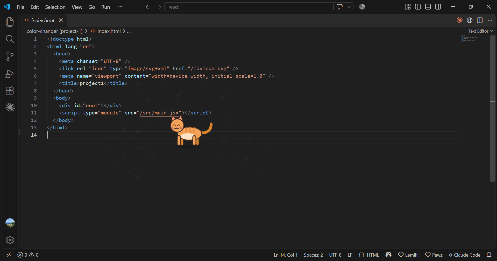

# Lemiki™ 🐈

**A little pet (cat, dog, rabbit, hamster or pigeon) that lives on your desktop and reacts to your coding.**

🌐 Website: https://jatin-jain-123.github.io/lemiki/

| Platform | Link |
|---|---|
| Microsoft Store (desktop app) | https://apps.microsoft.com/detail/9N3KJWB1CTH1 |
| VS Code Marketplace (extension) | https://marketplace.visualstudio.com/items?itemName=Jatin-Jain.lemiki |

## What it does
- Five pets to pick from: cat, dog, rabbit, hamster, pigeon.
- Wanders your screen on its own: walks, sits, naps, stretches.
- Optional start with Windows.
- With the VS Code extension: celebrates passing builds, gets sad on failed tests, glances over when you type.
- Click-through: never blocks your mouse or keyboard.
- Private: collects nothing. See the [privacy policy](https://jatin-jain-123.github.io/lemiki/privacy.html).

## About this repo
This repo only hosts the public website (GitHub Pages). The app's source code is private.

| File | What it is |
|---|---|
| `index.html` | Home page: title, tagline, description, screenshots, download links |
| `privacy.html` | Privacy policy |
| `styles.css` | Look and feel for both pages |
| `assets/` | Logo |
| `screenshots/` | App screenshots |

To update the site: edit the files and push to `main`. GitHub Pages republishes in about a minute.

## Support
Email jatin321jain@gmail.com

## Legal
© 2026 Jatin Jain. All rights reserved. Lemiki™ is a trademark of Jatin Jain. The app is not open source.
